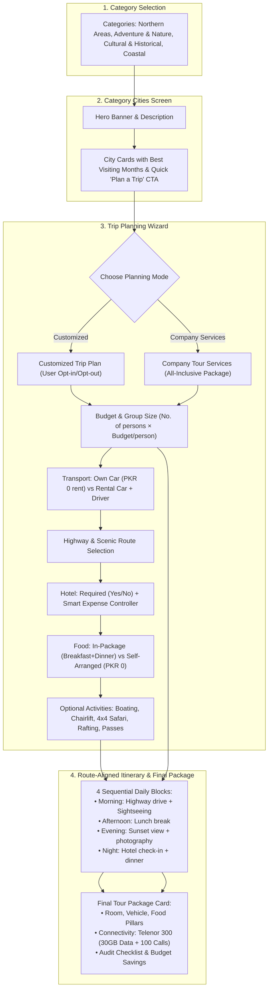

# Smart Travel Planner

Smart Travel Planner is a React Native/Expo mobile app with a Node.js/Express backend and a Python/FastAPI recommendation service. The agreed laptop-demo implementation is complete; the evidence-based assessment is **99% externally verified**, with only physical-device and representative-user acceptance remaining. See `plan.md` for the calculation.

Implemented in this milestone:

- Real signup/login using JWT.
- Password hashing with bcrypt.
- Session persistence using AsyncStorage.
- Local MongoDB user and trip storage.
- Backend weather endpoint using OpenWeather when configured, with fallback weather data when no key is present.
- Groq itinerary generation using weather and Wikipedia attractions, with a validated rule fallback.
- Daily route generation through OpenRouteService when configured, with a coordinate estimate fallback.
- Versioned local hotel recommendations with persisted hotel selection.
- Route-aware dynamic budget categories and over-budget warning.
- MongoDB trip history and recommendation interaction logging.
- Modular Expo frontend with one shared current trip across itinerary, map, hotels, and budget.
- Trip regeneration plus manual itinerary add/edit/remove/reorder.
- Real OpenStreetMap tiles with daily markers and route lines.
- Actual-expense add/edit/delete tracking and estimated-versus-actual totals.
- Wikipedia-backed attraction details and source links.
- System itinerary sharing and printable PDF export.
- Native local notification permission and demo trip reminders.
- Account-aware, read-only Groq travel chat covering saved trip history, active itineraries, budgets, expenses, hotels, routes, weather, preferences, alerts, and recent app activity, with saved sessions and deterministic fallback.
- Safe cross-platform Markdown rendering for chat and generated narrative content, plus escaped Markdown-aware share/PDF export.
- Evaluated recommendation benchmark using real Mendeley tourism data, a versioned Pakistan cold-start ranker, and deterministic fallback.
- Persistent weather/budget/route alerts with local notification scheduling.
- Profile editing, consent controls, data export/deletion, activity replacement search, impact preview, and recommendation explanations.
- Saved-trip restoration across login sessions, account-wide chatbot context, and saved-trip selection on the map.
- Destination-aware route geocoding validation that rejects wrong-country matches.
- Helmet security headers, API rate limiting, sanitized errors, and external-data caching.
- **Dedicated Category Destinations & Seasons Screen (`CategoryCitiesScreen`)**: Full-page interactive destination explorer with category hero banners, ratings, top attractions, and explicit **Best Visiting Months** badges (e.g. *"May to October"*, *"December to February"*) replacing dropdowns.
- **Dual Journey Planning Modes**:
  - `Mode A: Customized Trip Plan`: Granular user control over vehicle, hotel, food, and activities. Opted-out items (Own Car, No Hotel, Self-arranged food, unselected activities) cost PKR 0 and are NOT cut from the budget.
  - `Mode B: Company Tour Services`: Commercial all-inclusive tour package bundling verified lodging, dedicated chauffeur vehicle, fuel, highway tolls, daily breakfast & dinner buffets, and emergency support.
- **Supervisor Smart Expense Controller (35/35/15/10/5 Budget Allocation)**:
  - Transport (35%), Hotel/Stay (35%), Food & Dining (15%), Activities & Sights (10%), Safety Margin (5%).
- **Transport Breakdown (Own Car vs. Rental)**:
  - `Own Car`: Vehicle rental cost = **PKR 0** (explicitly preserved in remaining budget). Optional mountain driver (+PKR 2,000/day vs PKR 0 self-drive).
  - `Rental Car`: Vehicle auto-selected and filtered by passenger capacity (1-3p Alto/WagonR, 3-4p Civic/Corolla, 4-6p Prado/Fortuner 4x4, 7-12p HiAce Grand Cabin, 13-22p Coaster Salon) + mountain driver allowance.
- **Highway & Scenic Route Selection**:
  - Category-curated highways and mountain passes (Hazara Motorway M-15 + KKH, Babusar Pass, Makran Coastal Highway N-10, M-2, Swat Expressway M-16) with custom mountain pass text input.
- **Smart Hotel Expense Controller**:
  - Hotel toggle: No Hotel Required = **PKR 0** deduction.
  - Smart Filter Rule 1: Daily hotel budget `< PKR 3,000/night` hides 4★/5★ luxury resorts and presents verified budget guest houses.
  - Smart Filter Rule 2: Daily hotel budget `≥ PKR 7,000/night` unlocks 4★ and 5★ luxury suites and resorts.
- **Food Policy Controller**:
  - In-Package (complimentary hotel breakfast + fixed-menu dinner) vs Self-Arranged Meals (PKR 0 deduction).
- **Optional High-Cost Activities Checklist**:
  - Checkbox selection for Lake Boating (PKR 1,500/p), Mountain Chairlifts (PKR 1,200/p), 4x4 Jeep Safari (PKR 6,000/group), White Water Rafting (PKR 2,500/p), Heritage Passes (PKR 800/p). Unselected activities cost PKR 0.
- **4-Block Sequential Daily Schedules**:
  - Morning (Highway drive + Sightseeing stop), Afternoon (Lunch break), Evening (Sunset view + photography), Night (Hotel check-in + dinner).
- **Bookme.pk Tour Package Summary with 4 Pillars & Connectivity**:
  - Total package cost and price per person.
  - 1. Room Pillar (VIP Luxury Suite / Deluxe Room with lodging location).
  - 2. Vehicle Pillar (Own Car PKR 0 vs Dedicated Tour Car + Driver status).
  - 3. Food Pillar (Breakfast + Dinner policy).
  - 4. Connectivity Banner (Telenor 300 Tourist SIM Pack: 30GB 4G High-Speed Data + 100 All-Network Minutes).
  - Comprehensive package inclusions & audit checklist.

## Project Structure

```text
Travel planner/
  backend/              Node.js + Express API
  frontend/             Expo / React Native app
  ml/                   Training pipeline, artifacts, tests, and FastAPI inference
  scripts/              Helper scripts for running and testing
  AGENT_SETUP.md        Autonomous fresh-PC operating instructions
  FEATURES.md           Complete v1.0.0 feature manifest
  CLIENT_DELIVERY.md    Delivery contents and acceptance rules
  setup_fresh_pc.ps1    Idempotent Windows bootstrap
  plan.md               Project roadmap and progress checklist
  run_all.ps1           Starts backend and frontend together
```

Release version is stored in `VERSION`. The source is `v1.0.0` for the completed laptop-demonstration scope. Physical-device and human usability acceptance remain external activities.

## Customized vs. Company Tour Services Workflow



### Smart Expense Controller Formulas & Rules

1. **Budget Distribution Formulas**:
   $$\text{Total Budget} = \text{Persons} \times \text{Budget Per Person}$$
   - **Mode A: Customized Trip**:
     - Transport: $35\%$
     - Hotel/Stay: $35\%$
     - Food: $15\%$
     - Activities & Sights: $10\%$
     - Contingency Safety Margin: $5\%$
   - **Mode B: Company Tour Package**:
     - **Company Profit Deduction**: $\text{Company Profit} = \text{Total Budget} \times 10\%$
     - Hotel/Stay: $35\%$
     - Transport: $30\%$
     - Food: $15\%$
     - Activities & Sights: $5\%$
     - Contingency Safety Margin: $5\%$

2. **Transport Cost Logic**:
   - **Own Car**: Car rental cost = $\text{PKR } 0$ (not deducted from budget). Optional mountain driver toggle: $+\text{PKR } 2,000/\text{day}$ if requested, else $\text{PKR } 0$ for self-drive.
   - **Rental Car**: Matched to group size:
     - 1–3 persons: Suzuki Alto / WagonR ($\text{PKR } 3,500/\text{day}$ rent $+ \text{PKR } 3,000/\text{day}$ fuel)
     - 3–4 persons: Honda Civic / Toyota Corolla ($\text{PKR } 6,000/\text{day}$ rent $+ \text{PKR } 4,000/\text{day}$ fuel)
     - 4–6 persons: Toyota Prado / Fortuner 4x4 ($\text{PKR } 11,000/\text{day}$ rent $+ \text{PKR } 6,500/\text{day}$ fuel)
     - 7–12 persons: Toyota HiAce Grand Cabin ($\text{PKR } 14,000/\text{day}$ rent $+ \text{PKR } 8,000/\text{day}$ fuel)
     - 13–22 persons: Toyota Coaster Salon ($\text{PKR } 22,000/\text{day}$ rent $+ \text{PKR } 12,000/\text{day}$ fuel)
     - Driver allowance: $\text{PKR } 2,000/\text{day}$ when driver toggle is YES.

3. **Hotel Smart Filter Rules**:
   - $\text{Daily Hotel Budget} = \frac{\text{Budget} \times 0.35}{\text{Nights}}$
   - **Rule 1 ($\text{Daily Hotel Budget} < \text{PKR } 3,000$):** Hides 4★ and 5★ luxury hotels. Presents clean budget guest houses, motels, and family lodges.
   - **Rule 2 ($\text{Daily Hotel Budget} \ge \text{PKR } 7,000$):** Unlocks 4★ and 5★ luxury suites, resorts, and panoramic VIP rooms.
   - **No Hotel Toggle:** If user chooses *Hotel Required = NO*, hotel cost is $\text{PKR } 0$ and is not deducted from budget.

4. **Food & Meal Policy**:
   - **In Package:** Morning breakfast complimentary with hotel room stay + nightly warm fixed-menu dinner ($\text{PKR } 1,400/\text{person}/\text{night}$). Lunch self-paid at roadside eateries.
   - **Self-Arranged:** Food cost = $\text{PKR } 0$ deducted from budget.

5. **Optional Activities Controller**:
   - Standard sightseeing and heritage viewpoint stops are included free.
   - Only selected high-cost paid adventures are deducted:
     - Lake Boating & Jet Ski: $\text{PKR } 1,500/\text{person}$
     - Mountain Chairlift & Cable Car: $\text{PKR } 1,200/\text{person}$
     - 4x4 Mountain Jeep Safari: $\text{PKR } 6,000/\text{group}$
     - White Water River Rafting: $\text{PKR } 2,500/\text{person}$
     - UNESCO Heritage & Park Passes: $\text{PKR } 800/\text{person}$
   - Unchecked activities cost $\text{PKR } 0$ and leave budget intact.

6. **Bookme.pk Tour Package with 4 Pillars & Connectivity**:
   - **Pillar 1 (Room):** Room category (VIP Suite, Deluxe, or Self-Arranged), hotel name & destination location.
   - **Pillar 2 (Vehicle):** Own Car vs dedicated rental car with chauffeur and fuel status.
   - **Pillar 3 (Food):** Breakfast & Dinner policy.
   - **Pillar 4 (Connectivity):** Telenor 300 Tourist SIM Pack (30GB 4G High-Speed Data + 100 All-Network Minutes).

## New Machine Setup

For an autonomous or one-command setup, follow `AGENT_SETUP.md` and run this from an elevated PowerShell terminal:

```powershell
Set-ExecutionPolicy -Scope Process -ExecutionPolicy Bypass
.\setup_fresh_pc.ps1
```

The bootstrap installs missing tools with `winget`, starts local MongoDB, creates safe local environment files, installs locked dependencies, creates `.venv`, and runs the complete test suite. The manual steps below are provided for developers who need individual control.

### 1. Install Required Tools

Install:

- Node.js LTS 20 or newer: `https://nodejs.org/`
- Git: `https://git-scm.com/`
- VS Code: `https://code.visualstudio.com/`
- Expo Go on your phone if you want to test on a physical device.
- Python 3.12 for the pinned ML training/inference environment.
- MongoDB Community Server with its Windows service enabled.

Verify tools in PowerShell:

```powershell
node --version
npm --version
git --version
python --version
```

### 2. Open The Project

Clone or copy the project folder to the new machine, then open PowerShell in the repo root.

Example:

```powershell
cd "F:\Travel planner"
```

If PowerShell blocks local scripts, run this once in the current terminal:

```powershell
Set-ExecutionPolicy -Scope Process -ExecutionPolicy Bypass
```

### 3. Install Dependencies

Install backend packages:

```powershell
cd backend
npm ci
```

Install frontend packages:

```powershell
cd ..\frontend
npm ci
```

Return to repo root:

```powershell
cd ..
```

Install ML packages:

```powershell
python -m venv .venv
.\.venv\Scripts\python.exe -m pip install -r ml\requirements.txt
```

## Local MongoDB Setup

No Docker is required.

The laptop demonstration uses the installed local MongoDB Windows service. No Atlas account or Docker installation is required.

Verify the service in PowerShell:

```powershell
Get-Service MongoDB
```

It should report `Running`. The backend configuration is:

```env
LOCAL_MONGODB_URI=mongodb://127.0.0.1:27017/smart-travel-planner
```


## Environment Files

### Backend

Create `backend/.env` from `backend/.env.example`.

PowerShell:

```powershell
Copy-Item backend\.env.example backend\.env
```

Edit `backend/.env`:

```env
PORT=5000
LOCAL_MONGODB_URI=mongodb://127.0.0.1:27017/smart-travel-planner
JWT_SECRET=replace-with-a-long-random-secret
OPENWEATHER_API_KEY=
GROQ_API_KEY=
GROQ_MODEL=qwen/qwen3.6-27b
GROQ_BASE_URL=https://api.groq.com/openai/v1
GROQ_TIMEOUT_MS=25000
OPENROUTESERVICE_API_KEY=
OPENROUTESERVICE_BASE_URL=https://api.openrouteservice.org
ML_SERVICE_URL=http://127.0.0.1:8000
ML_TIMEOUT_MS=3000
CORS_ORIGIN=http://localhost:8081,http://localhost:19006,http://localhost:3000
```

`OPENWEATHER_API_KEY` is optional. If it is empty, the backend uses fallback weather data.
`GROQ_API_KEY` is optional for local setup. If it is empty or Groq fails, the backend uses validated deterministic itinerary and account-aware chat fallbacks. `GROQ_MODEL` is configurable because provider model availability can change.
`OPENROUTESERVICE_API_KEY` is optional. With a key, the backend validates Pakistan/destination geocodes and requests driving geometry; without it, known coordinates produce a clearly labeled distance/time estimate.

### Frontend

Create `frontend/.env` from `frontend/.env.example`.

PowerShell:

```powershell
Copy-Item frontend\.env.example frontend\.env
```

For Expo web on the same PC, use:

```env
EXPO_PUBLIC_API_BASE_URL=http://localhost:5000/api
```

For the standard Android emulator, use the host alias:

```env
EXPO_PUBLIC_API_BASE_URL=http://10.0.2.2:5000/api
```

For a physical phone, replace `localhost` with your PC's LAN IP:

```env
EXPO_PUBLIC_API_BASE_URL=http://YOUR_PC_IP:5000/api
```

## Run The Project

From repo root, run:

```powershell
.\run_all.ps1
```

This opens three PowerShell windows:

- FastAPI recommendation service on port `8000` or the next free port.
- Backend API on port `5000` or the next free port.
- Expo frontend connected to the matching backend URL.

The launchers reuse installed lockfile dependencies and the repository `.venv`; they no longer reinstall everything on every run.

For phone testing, pass your PC IP:

```powershell
.\run_all.ps1 -ApiBaseUrl "http://YOUR_PC_IP:5000/api"
```

You can also run backend and frontend separately:

```powershell
.\scripts\start-backend.ps1
.\scripts\start-frontend.ps1 -ApiBaseUrl "http://localhost:5000/api"
```

## Verify The Setup

The required fresh-PC acceptance command is:

```powershell
.\scripts\test-100.ps1
```

It must finish with `100% automated integration suite passed.` The smaller suites below remain useful for targeted diagnosis.

Run the regression smoke test from repo root:

```powershell
.\scripts\test-50.ps1
```

Expected result:

```text
50% smoke test passed on port 5000
```

This test checks:

- Backend health endpoint.
- MongoDB connection.
- Signup.
- Login.
- Authenticated `/me`.
- Weather endpoint.
- Trip generation.
- Trip listing.
- Trip detail fetch.
- Trip deletion.

Run the complete 80% test:

```powershell
.\scripts\test-80.ps1
```

To use an isolated local test database:

```powershell
.\scripts\test-80.ps1 -MongoUri "mongodb://127.0.0.1:27017/smart-travel-planner-test"
```

The 80% suite additionally verifies hotel filtering, route generation/fallback, dynamic budget calculation, interaction logging, complete trip generation/regeneration, itinerary edits, actual-expense CRUD, attraction-source access, selected-hotel persistence, contextual chat persistence/fallback, ownership, and cleanup.

Run the final automated suite:

```powershell
.\scripts\test-100.ps1
```

This rebuilds the recommendation artifacts, runs the Python unit tests, starts the real FastAPI service, and runs the expanded API/MongoDB integration suite. The final suite also verifies profile/privacy lifecycle, recommendation provenance, change preview, alerts, cross-user isolation, and account cleanup.

## Backend Endpoints

Base URL:

```text
http://localhost:5000/api
```

Available endpoints:

- `GET /health`
- `POST /auth/signup`
- `POST /auth/login`
- `GET /auth/me`
- `PATCH /auth/me/preferences`
- `PATCH /auth/me`
- `GET /auth/me/export`
- `DELETE /auth/me`
- `GET /weather?city=Lahore&days=3`
- `POST /trips/generate`
- `GET /trips`
- `GET /trips/:id`
- `PATCH /trips/:id`
- `PATCH /trips/:id/itinerary`
- `PATCH /trips/:id/hotel`
- `POST /trips/:id/change-preview`
- `POST /trips/:id/expenses`
- `PATCH /trips/:id/expenses/:expenseId`
- `DELETE /trips/:id/expenses/:expenseId`
- `DELETE /trips/:id`
- `GET /attractions?city=Lahore&interests=History`
- `POST /chat`
- `GET /chat`
- `GET /chat/:id`
- `POST /chat/:id/messages`
- `DELETE /chat/:id`
- `POST /routes`
- `GET /hotels?city=Lahore&budget=200000&days=3`
- `POST /budget/calculate`
- `POST /interactions`
- `POST /recommendations`
- `GET /alerts`
- `PATCH /alerts/:id/read`
- `PATCH /alerts/read-all`

Trip endpoints require a JWT bearer token.

## Common Issues

### Database Is Not Configured

Cause:

- `LOCAL_MONGODB_URI` is missing or empty in `backend/.env`.

Fix:

- Set `LOCAL_MONGODB_URI=mongodb://127.0.0.1:27017/smart-travel-planner` in `backend/.env`.
- Restart the backend.

### MongoDB Connection Fails

Common causes:

- The MongoDB Windows service is stopped.
- Port `27017` is already occupied or blocked.
- `LOCAL_MONGODB_URI` points to the wrong host or database.

### Phone Cannot Reach Backend

Cause:

- `localhost` on a phone points to the phone, not your PC.

Fix:

- Use your PC LAN IP in `EXPO_PUBLIC_API_BASE_URL`.
- Allow port `5000` through Windows Firewall if needed.

### Weather Uses Fallback Data

Cause:

- `OPENWEATHER_API_KEY` is empty.

Fix:

- Add an OpenWeather key to `backend/.env`.
- Restart the backend.

## Current Limitations

These are the remaining external or production-only limitations:

- Live OpenRouteService directions require an `OPENROUTESERVICE_API_KEY`; otherwise the app uses known coordinates and an estimate fallback.
- Hotel prices are dated planning estimates, not booking quotes or live availability. Provenance is documented in `backend/src/data/README.md`.
- The app renders OpenStreetMap tiles through Leaflet on web and a WebView on native; this requires internet access and is not an offline map.
- The Pakistan runtime ranker is a content-based cold-start model trained with labeled semi-synthetic preference profiles. Its real-data benchmark proves the algorithm pipeline, not direct collaborative accuracy for Pakistani travelers.
- Server alerts schedule local-device notifications when the app refreshes them; unattended cloud push delivery is not part of the laptop demo.
- PDF/system sharing, local notifications, and the native app compile and launch on Android API 35, but final behavior still needs one physical-device acceptance pass.
- A five-person usability/accessibility study remains an external acceptance activity and is not represented as completed by automated tests.

## Delivery

Create a sanitized source-only client release while preserving older deliveries:

```powershell
.\scripts\create-client-delivery.ps1 -Version 1.0.0
```

The builder uses an explicit source whitelist, rejects secrets and heavy/generated folders, validates required ZIP entries, and updates `delivered/SHA256SUMS.txt`. See `CLIENT_DELIVERY.md` for the package contract and `FEATURES.md` for the complete feature list.
